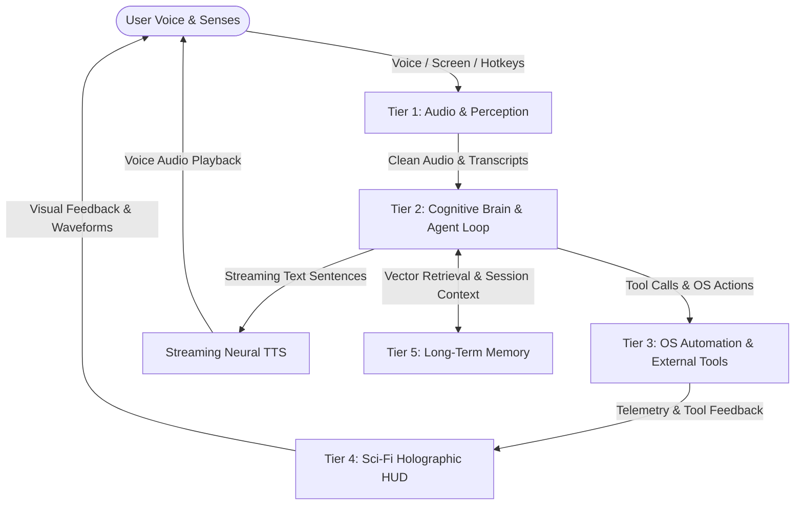

# 🤖 PROJECT JARVIS: ARCHITECTURAL MASTER PLAN & BLUEPRINT

> **MANDATORY INSTRUCTION FOR AI AGENTS & DEVELOPERS**:  
> **YOU MUST READ THIS ENTIRE DOCUMENT BEFORE MAKING ANY CODE OR ARCHITECTURAL CHANGE.**  
> Every modification to the codebase must strictly adhere to the tier structure, latency budgets, and safety boundaries defined herein.

---

## 1. System Vision & Overview

**JARVIS** (Just A Rather Very Intelligent System) is a voice-first, low-latency, multimodal autonomous AI assistant for Windows OS.

### Key Pillars:
1. **Instant Voice Duplex (< 800ms Time-to-First-Audio)**:
   - Voice Activity Detection (VAD) + Wake Word ("Jarvis" / "Hey Jarvis").
   - Ultra-fast Speech-to-Text (STT) and streaming Neural Text-to-Speech (TTS).
2. **Cognitive Agent Brain**:
   - Advanced reasoning engine with tool calling, context tracking, and proactive intelligence.
   - Distinctive witty, sophisticated, respectful British butler persona.
3. **Deep Windows OS Integration**:
   - Audio volume, media playback, brightness, window controls, application launching/switching, process monitoring.
4. **Multimodal Awareness**:
   - Screen awareness (analyzing active windows or full screen on demand).
   - Webcam sight (identifying objects and reading physical items).
5. **Sci-Fi Holographic HUD (Face of JARVIS)**:
   - High-tech interactive dashboard featuring an animated Arc Reactor core, real-time audio waveforms, telemetry gauges, and live event logs.
6. **Episodic & Semantic Memory**:
   - Persistent memory storing user preferences, habitual actions, and personal context.

---

## 2. Five-Tier System Architecture



---

## 3. Subsystem Specifications

### Tier 1: Voice & Sensory Pipeline (The Ears & Mouth)
* **Wake-Word & VAD Engine**:
  * Voice Activity Detection using `Silero VAD` to accurately isolate speech frames.
  * Wake-word listener using `openWakeWord` or custom hotkey trigger (`Ctrl+Space` push-to-talk fallback).
* **Speech-to-Text (STT)**:
  * Primary: High-speed local `faster-whisper` (CTranslate2 Whisper base.en / small.en) or streaming Cloud STT (Deepgram Nova-2 / Sarvam AI STT).
  * Microphone capture via `sounddevice` / `pyaudio`.
* **Text-to-Speech (TTS)**:
  * Primary: `edge-tts` with high-definition neural voices (`en-GB-RyanNeural` or `en-US-ChristopherNeural`).
  * Chunk-based streaming playback using `pygame` / `miniaudio` / `sounddevice` to stream speech as sentences complete.

### Tier 2: The Cognitive Brain & Agent Core
* **Reasoning Engine**:
  * Fast LLM inference with native function/tool calling (Gemini 1.5 Flash / Groq Llama 3.3 / Claude / OpenAI / Local Ollama).
* **Spoken Response Persona**:
  * Concise, natural, spoken sentences (no unpronounceable markdown tables, raw links, or code blocks in spoken audio).
  * Detailed responses, tables, and code snippets are automatically routed to the visual HUD display instead.
* **Safety Protocols**:
  * High-risk operations (terminating processes, executing destructive shell scripts, deleting files) require explicit verbal or UI confirmation.

### Tier 3: OS Automation & Environment Tools (The Hands)
* **Windows Controller (`jarvis.tools.os_controller`)**:
  * Master volume, mute/unmute (`pycaw`).
  * Display brightness (`screen_brightness_control`).
  * Process & app management (`psutil`, `subprocess`): launching Chrome, VS Code, Spotify, Discord, Notepad, etc.
  * Media controls: Play/pause, next track, previous track.
  * Window management: Minimize, maximize, tile left/right (`win32gui`, `win32con`).
* **Web & Information Tools (`jarvis.tools.web_tools`)**:
  * Real-time web search for current events and queries.
  * Weather forecasts, calendar, system health statistics.
* **Vision & Screen Understanding (`jarvis.tools.vision_tools`)**:
  * Screen capture (`pyautogui` / `mss`) + LLM vision analysis to describe or troubleshoot whatever is on the user's screen.

### Tier 4: Sci-Fi Holographic HUD (The Face)
* **Design & Aesthetics**:
  * Palette: Deep Obsidian (`#080c14`), Neon Cyan (`#00f0ff`), Quantum Blue (`#0066ff`), Core Gold (`#ffb700`).
  * Animated Arc Reactor core with rotating magnetic rings, glowing plasma core, and particle field.
  * Live dynamic audio visualizer responding to microphone input and JARVIS's voice.
  * Real-time hardware telemetry: CPU, RAM, Disk, Network speed, and latency timers.
  * Terminal-style live execution log and transcript stream.
* **Architecture**:
  * Lightweight web UI served by FastAPI backend over WebSockets for zero-delay state sync.

### Tier 5: Long-Term Memory & Context (The Memory)
* **Short-Term Context**: Sliding conversational window with token-aware truncation.
* **Episodic Knowledge Base**:
  * SQLite database storing past sessions, timestamps, and interaction logs.
  * Vector embeddings (`ChromaDB` / `sentence-transformers`) for recalling user preferences, project knowledge, and personal instructions.

---

## 4. Directory & Codebase Layout

```text
d:\SERVAM_AI/
├── JARVIS_MASTER_PLAN.md      <-- THIS FILE (Always read before changing code)
├── README.md                  <-- Project introduction & quickstart
├── requirements.txt           <-- Python dependencies
├── config/
│   ├── config.yaml            <-- Config settings (voices, models, hotkeys)
│   └── settings.py            <-- Configuration loader & environment variables
├── jarvis/
│   ├── __init__.py
│   ├── audio/                 <-- Tier 1: STT, TTS, VAD, Wake-word
│   │   ├── __init__.py
│   │   ├── recorder.py        <-- Microphone stream & VAD
│   │   ├── stt.py             <-- Speech-to-text engine
│   │   ├── tts.py             <-- Neural text-to-speech engine
│   │   └── wake_word.py       <-- Wake word listener
│   ├── brain/                 <-- Tier 2: LLM orchestration & prompt matrix
│   │   ├── __init__.py
│   │   ├── agent.py           <-- Core agentic loop & tool executor
│   │   └── prompts.py         <-- Persona & system prompts
│   ├── tools/                 <-- Tier 3: OS & external tool implementations
│   │   ├── __init__.py
│   │   ├── os_control.py      <-- Volume, brightness, apps, media
│   │   ├── sys_info.py        <-- CPU, RAM, battery, network metrics
│   │   ├── web_tools.py       <-- Web search & weather
│   │   └── vision_tools.py    <-- Screen capture & vision inspection
│   ├── memory/                <-- Tier 5: Vector & SQL memory store
│   │   ├── __init__.py
│   │   └── memory_manager.py  <-- Persistent user preferences & history
│   └── server/                <-- Backend API & WebSocket server
│       ├── __init__.py
│       └── app.py             <-- FastAPI server bridging backend to HUD
├── hud/                       <-- Tier 4: Futuristic Sci-Fi Web Interface
│   ├── index.html             <-- HUD layout & Arc Reactor canvas
│   ├── styles.css             <-- Sci-Fi glassmorphic HUD styling
│   └── app.js                 <-- WebSocket client & audio visualizer
└── run_jarvis.py              <-- Main execution entry point
```

---

## 5. Phased Roadmap

| Phase | Objective | Deliverables | Status |
| :--- | :--- | :--- | :--- |
| **Phase 1A** | **Cognitive Router & Agent Core** | Multi-provider failover (OpenRouter/Groq/Gemini/Ollama/Sarvam), multi-key rotation, ₹0 cost guard, `JarvisAgent` conversation loop, interactive CLI (`run_jarvis.py`) | 🟢 Completed |
| **Phase 1B** | **Voice Pipeline (Ears & Mouth)** | Streaming Neural & Windows SAPI TTS, microphone capture with RMS energy VAD, fast STT (`faster-whisper`), voice CLI integration | 🟢 Completed |
| **Phase 2** | **OS Automation & Agent Tools** | Master volume, media controls, app launcher (`launch_application`), CPU/RAM/Disk/Battery metrics (`sys_info`), DuckDuckGo & Weather tools | 🟢 Completed |
| **Phase 3** | **Sci-Fi Holographic HUD** | Arc Reactor core animation, Web Audio waveform visualizer, system telemetry gauges, FastAPI WebSocket sync (`jarvis.server`, `hud/`) | 🟢 Completed |
| **Phase 4** | **Vision & Long-Term Memory** | Screen awareness (`mss` + vision LLM), SQLite episodic & preference store (`MemoryManager`), user preference tracking & context injection | 🟢 Completed |
| **Phase 5** | **Wake-Word & Continuous Autonomy** | Background wake-word listening (`openWakeWord`), proactive reminders, Windows startup service | 🟡 Ready to Begin |

---

## 6. Strict Development Rules

1. **Rule of the Master Plan**: Before writing, modifying, or refactoring ANY file in this repository, you MUST read this document (`JARVIS_MASTER_PLAN.md`).
2. **Rule of Modularity**: Do not combine audio, tools, and UI logic into a single monolithic script. Every component must live in its respective directory.
3. **Rule of Latency**: Voice feedback is the primary human interface. Any operation in the voice path must be non-blocking and streamed.
4. **Rule of Graceful Fallbacks**: If hardware acceleration or an API key is missing, the system must gracefully fall back (e.g., cloud STT -> local Whisper -> text input mode) without crashing.
5. **Rule of Safety**: System modifications (killing processes, deleting files) must confirm intent before execution.
